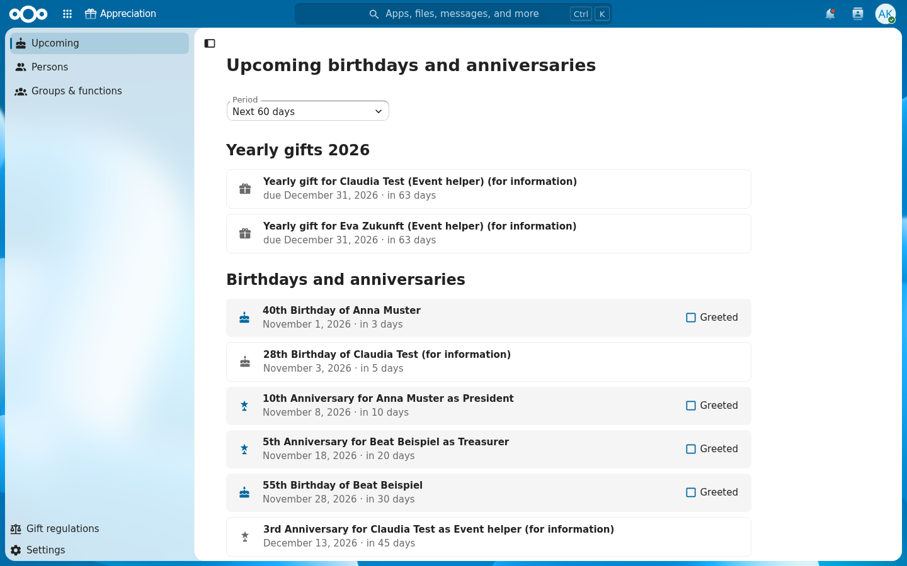

<!--
  - SPDX-FileCopyrightText: 2026 Adrian Dymorz <dev@adrian.dymorz.ch>
  - SPDX-License-Identifier: AGPL-3.0-or-later
-->

# Appreciation

Manage the people engaged in your organization (members, employees, elected officials, volunteers) and never miss their birthdays and work anniversaries (jubilees).

Requires Nextcloud 34 or 35 (PHP 8.2 or newer). Available in English and German. Report bugs and ideas in the [issue tracker](https://github.com/adymorz/nextcloud-appreciation-app/issues).



## Features

- **Persons** with date of birth, address, phone numbers and notes, and their **functions** over time (e.g. "Treasurer" from 2021 to 2024) in **groups** (e.g. "Board").
- **Birthdays and jubilees** are generated automatically for the next 400 days, for every person who currently holds a function.
- **Yearly gifts**: functions can be marked "One gift per year", so the responsible person is reminded to present one gift per calendar year to everybody holding them.
- **Calendar**: everybody involved in a group gets a read-only calendar "Birthdays & anniversaries" in the Calendar app and on CalDAV devices, with a reminder before each event (yearly gifts have no fixed day and are not in the calendar).
- **Reminders**: a Nextcloud notification when an event comes within the lead time (default 14 days), optionally also by email.
- **Upcoming** view with a "greeted" checklist for the responsible persons, and the yearly gifts of the year with a "presented" checklist.
- **Data sheet** per person to print (or save as PDF) and hand over, so the person can check, correct and complete their data. Notes are never printed.
- **Audit log** of who created, changed or deleted master data.

### Roles

| Role | Who | Can |
| --- | --- | --- |
| Manager | Nextcloud admins and members of the manager group (admin settings) | See and edit everything, see the audit log |
| Responsible person | Exactly one Nextcloud user per group | See the current members of the group including date of birth, contact data and notes, print their data sheets, get their events, mark events as greeted and yearly gifts as presented |
| Interested person | Any number of Nextcloud users per group | See the current members of the group (name and functions) and get their events "(for information)" |
| Everybody else | | No access; the app is not shown in the navigation |

Access is checked on the server for every request. Persons themselves need no Nextcloud account.

### Birthdays and jubilees

- A **birthday** is generated when the person holds an active function on that day. It goes to all groups of those functions.
- A **jubilee** is counted per function from the start of the continuous service period: time slices that follow each other without a gap (e.g. a re-election) count as one period. It is generated in the jubilee years (global list, can be overridden per group) while the period is open, or if it ended on or after the jubilee date.
- Birthdays and period starts on February 29 fall on February 28 in other years.
- Titles follow the language of each user, e.g. "5th Anniversary for Anna Muster as Treasurer" or "40. Geburtstag von Anna Muster (zur Information)".

### Yearly gifts

- For a function marked "One gift per year", every person holding it on at least one day of a calendar year gets one **yearly gift** for that year, an open item for the function's group, e.g. "Yearly gift for Anna Muster (Treasurer)". Holding the function twice in the same year still gives one gift.
- It is due at the end of the year, or on the last day in the function if the person leaves it during the year. The reminder comes when the due date is within the lead time, unless the gift is already presented.
- The Upcoming view lists the gifts of every year in the selected period, including overdue ones of the current year. The responsible person and managers mark them as presented, also when the "greeted" checklist is turned off.
- Gifts are generated for the current and the next calendar year. Switching the function's yearly gift off removes the gifts of the current year, including presented ones; those of past years stay.

### Settings

- **Admin** (Administration settings → Groupware → Appreciation): manager group, jubilee years, reminder lead time, which events are generated, the "greeted" checklist, whether reminder emails are on by default, and the link to the gift regulations (an external page or the internal link of a file in Nextcloud), shown to all users in the app navigation.
- **Personal** (Settings at the bottom of the app navigation): reminder emails on or off.

## Installation

As an administrator, open **Apps**, search for "Appreciation" (category "Organization") and click **Download and enable**, or run `occ app:install appreciation`.

Then choose the manager group and adjust the jubilee years and reminders in Administration settings → Groupware → Appreciation. Background jobs (cron) must run, they generate the events and send the reminders hourly. Install the Calendar app to see the birthdays and anniversaries in a calendar.

## Development

The app is developed on a self-hosted GitLab, [GitHub](https://github.com/adymorz/nextcloud-appreciation-app) is a public mirror. The development environment is based on [DDEV](https://ddev.com). Docker and DDEV (v1.25 or newer) are the only requirements on your machine; PHP, Composer and Node.js run inside the DDEV containers.

### Getting started

```sh
git clone https://github.com/adymorz/nextcloud-appreciation-app.git
cd nextcloud-appreciation-app
ddev start             # the first start downloads and installs Nextcloud 35
ddev composer install  # PHP dev tools and the OCP API for IDE autocompletion
ddev npm ci
ddev npm run build     # or keep `ddev npm run watch` running while you work
ddev launch
```

Log in as `admin` / `admin`. The users `alice` / `alice` and `bob` / `bob` are created as well.

To get some data to work with, run `ddev occ appreciation:demo-data`. It creates two groups, where alice is responsible for "Demo: Board" and interested in "Demo: Volunteers" and bob the other way round, with persons whose birthdays and jubilees fall in the next weeks. Install the Calendar app (`ddev occ app:install calendar`) to see their calendars.

### How it works

- Nextcloud (release tarball, version set by `NEXTCLOUD_VERSION` in [.ddev/config.yaml](.ddev/config.yaml)) lives in a Docker volume at `/var/www/nextcloud` in the web container. Your working copy is at `/var/www/html` and is symlinked to `/var/www/nextcloud/apps-extra/appreciation`, so changes are live immediately.
- [.ddev/nextcloud/setup.sh](.ddev/nextcloud/setup.sh) runs on every `ddev start`. It downloads and installs Nextcloud on the first run, and afterwards only re-links the app, applies pending upgrades and enables the app.
- Development settings (debug mode, trusted domains, app paths, mail) are in [.ddev/nextcloud/ddev.config.php](.ddev/nextcloud/ddev.config.php).
- Background jobs run every 5 minutes (`nextcloud-cron` daemon in the web container).
- All outgoing mail is caught by Mailpit.

### Commands

| Command | Purpose |
| --- | --- |
| `ddev npm run watch` | Rebuild the frontend on every change |
| `ddev npm run lint` / `ddev npm run stylelint` | Lint JavaScript/TypeScript/Vue and styles |
| `ddev npm run typecheck` | Type check the frontend |
| `ddev composer lint` | Check PHP syntax |
| `ddev composer cs:check` / `ddev composer cs:fix` | Check / fix the PHP coding style |
| `ddev composer psalm` | Static analysis |
| `ddev composer rector` | Automated refactoring (then runs `cs:fix`) |
| `ddev composer test:unit` | PHPUnit tests: unit tests and integration tests against the instance database (they only remove the rows they created) |
| `ddev composer openapi` | Regenerate [openapi.json](openapi.json) after API changes, then `ddev npm run typescript:generate` for the frontend types |
| `ddev npm run l10n` | Check translations and compile `l10n/*.js`, see below |
| `ddev occ appreciation:sync` | Generate events and send due reminders now (otherwise hourly) |
| `ddev occ appreciation:demo-data` | Create demo data |
| `ddev exec scripts/appstore-package.sh` | Build the unsigned App Store archive in `build/appstore/` (after `ddev npm run build`), see [Releasing](#releasing) |
| `ddev occ <command>` | Run Nextcloud's `occ`, e.g. `ddev occ app:list` |
| `ddev occ log:watch` | Follow the Nextcloud log |
| `ddev mailpit` | Open Mailpit to see sent mails |
| `ddev xdebug on` / `ddev xdebug off` | Toggle Xdebug |
| `ddev nextcloud-reset` | Reinstall Nextcloud from scratch (database, users and files are lost) |
| `ddev nextcloud-reset --full` | Same, and download the server code again |

### Debugging with Xdebug

Run `ddev xdebug on` and listen on port 9003 in your IDE. For VS Code with the PHP Debug extension, add this to `.vscode/launch.json`:

```json
{
	"version": "0.2.0",
	"configurations": [
		{
			"name": "Listen for Xdebug (DDEV)",
			"type": "php",
			"request": "launch",
			"port": 9003,
			"pathMappings": {
				"/var/www/html": "${workspaceFolder}"
			}
		}
	]
}
```

Breakpoints work in the app's code. The Nextcloud server code is only available inside the container (`ddev ssh`, `/var/www/nextcloud`); the public API is available in `vendor/nextcloud/ocp` for reference.

### Updating Nextcloud

Change `NEXTCLOUD_VERSION` in [.ddev/config.yaml](.ddev/config.yaml) and run `ddev restart`. The server code is replaced and `occ upgrade` runs; your data is kept. Downgrades are not possible: `ddev restart` then only prints a warning, and `ddev nextcloud-reset --full` installs the configured version from scratch.

### Supporting Nextcloud 34 and 35

The app supports Nextcloud 34 and 35 and PHP 8.2 to 8.5. The development instance runs Nextcloud 35.

- `composer.json` pins `nextcloud/ocp` to the **lowest** supported version (`dev-stable34`), so autocompletion and psalm only offer API that exists in both. CI also runs psalm against `dev-stable35` and the PHP unit and integration tests in Nextcloud 34 and 35.
- Avoid PHP 8.3 syntax (e.g. typed class constants); CI lints on PHP 8.2.
- To try the app on Nextcloud 34 locally, run `ddev exec 'NEXTCLOUD_VERSION=34.0.5 bash /mnt/ddev_config/commands/web/nextcloud-reset --full'`. A later `ddev restart` upgrades the instance back to the configured Nextcloud 35, which also tests the upgrade path.

### Translations

Source strings are English: `$l->t('…')` in PHP and `t('appreciation', '…')` in the frontend. Translations live in [l10n/de.json](l10n/de.json) (German, informal) and [l10n/de_DE.json](l10n/de_DE.json) (German, formal). After adding or changing strings, add them to both files and run `ddev npm run l10n`: it lists missing and unused strings and writes the `l10n/*.js` files the frontend loads. CI fails if a translation is missing.

### Architecture

- `lib/Service`: domain logic. `EventCalculator` and `PeriodCalculator` compute the events, `EventService` keeps the `appreciation_events` table in sync, `AccessService` holds all permission rules, `Presenter` applies them to API responses.
- `lib/Controller`: OCS API (`/ocs/v2.php/apps/appreciation/api/v1/…`, documented in [openapi.json](openapi.json)) and the page.
- `lib/Calendar`: the calendar provider (public `ICalendarProvider` API).
- `lib/Notification`, `lib/BackgroundJob`, `lib/Command`, `lib/Settings`: notifier, hourly job, occ commands, admin settings form.
- `src`: Vue 3 frontend with `@nextcloud/vue`.

### Releasing

Releases go to the [Nextcloud App Store](https://apps.nextcloud.com/apps/appreciation) through the GitLab CI pipeline of a version tag. The release archives are attached to the GitHub releases of the mirror, from where the App Store and every Nextcloud server download them.

For each release:

1. Set the new version in [appinfo/info.xml](appinfo/info.xml) and `package.json`.
2. In [CHANGELOG.md](CHANGELOG.md), rename `## [Unreleased]` to `## X.Y.Z – YYYY-MM-DD` and add a new empty `## [Unreleased]` above it. The App Store only finds headings that start with the plain version (no brackets). Pre-releases (`X.Y.Z-beta.1`) take their notes from `## [Unreleased]`.
3. Merge to `main`, then tag and push: `git tag vX.Y.Z && git push origin vX.Y.Z`.

After all checks pass, `release:package` builds the archive and signs both the code (`appinfo/signature.json`) and the archive ([scripts/appstore-package.sh](scripts/appstore-package.sh)). `release:publish` then attaches it to the GitHub release and registers it in the App Store ([scripts/appstore-publish.sh](scripts/appstore-publish.sh)). The pipeline fails if the tag, the version in info.xml and the changelog heading don't match.

One-time setup:

1. **GitHub mirror**: a public repository `adymorz/nextcloud-appreciation-app` with issues enabled, created empty (no README or license) so the mirror can push to it. In GitLab, Settings → Repository → Mirroring repositories, push to `https://github.com/adymorz/nextcloud-appreciation-app.git` with a fine-grained GitHub token (Contents: read and write), including tags.
2. **Certificate**: the private key `appreciation.key` and the signing request `appreciation.csr` are in `~/.nextcloud/certificates/`. Never commit or share the key. The GitHub profile must show its email address, then submit the request as `appreciation/appreciation.csr` in a pull request to [nextcloud/app-certificate-requests](https://github.com/nextcloud/app-certificate-requests) and save the signed certificate as `~/.nextcloud/certificates/appreciation.crt`.
3. **App Store**: log in at [apps.nextcloud.com](https://apps.nextcloud.com) and [register the app](https://apps.nextcloud.com/developer/apps/new) with the certificate and the signature of the app ID: `echo -n appreciation | openssl dgst -sha512 -sign ~/.nextcloud/certificates/appreciation.key | openssl base64`.
4. **GitLab CI/CD**: protect the tags `v*` (Settings → Repository → Protected tags) and add these protected variables (Settings → CI/CD → Variables):

| Variable | Type | Value |
| --- | --- | --- |
| `APP_PRIVATE_KEY` | File | Contents of `appreciation.key` |
| `APP_CERTIFICATE` | File | Contents of `appreciation.crt` |
| `GITHUB_TOKEN` | Variable, masked | Fine-grained GitHub token for the mirror repository with "Contents: read and write" |
| `APPSTORE_TOKEN` | Variable, masked | API token from [apps.nextcloud.com/account/token](https://apps.nextcloud.com/account/token) |

## Known issues

- Nextcloud 35.0.2 rejects saving *personal* declarative settings for users that are neither admin nor subadmin (the settings app's `DeclarativeSettingsController::setValue` lacks `#[NoSubAdminRequired]`). The personal setting of this app is therefore in the app itself.

## License

[AGPL-3.0-or-later](LICENSE)
